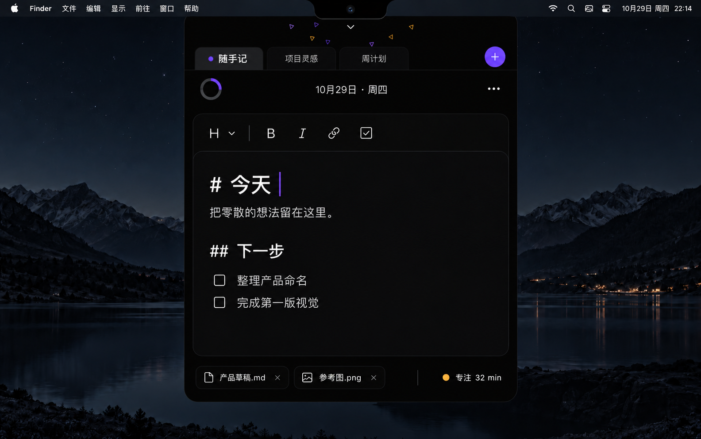
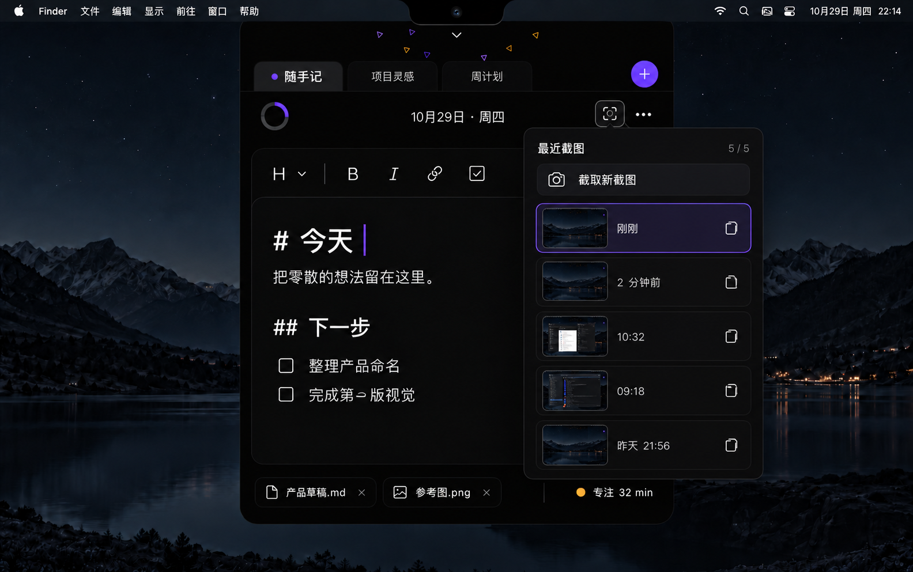
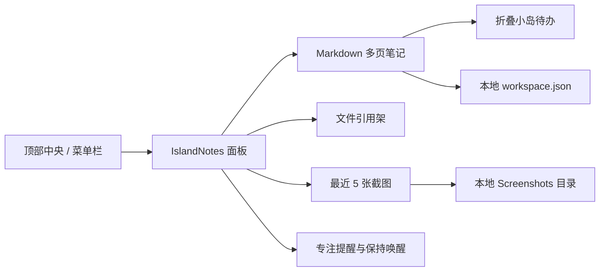

# IslandNotes

> 把 Markdown 笔记、待办、临时文件和专注状态，收进 Mac 屏幕顶部的一座小岛。

IslandNotes 是一款为 **macOS 14+** 打造的轻量菜单栏笔记应用。点一下屏幕顶部中央即可展开面板，记下想法、整理待办、暂存文件；收起后，它会用一个紧凑的顶部小岛继续显示当前任务与专注状态。

无需账号，也没有云端同步。笔记、设置与截图都保存在本机。



## 一分钟了解

| 你可以用它做什么 | IslandNotes 如何帮你 |
| --- | --- |
| 随手记录 | 点按屏幕顶部中央或菜单栏图标，立即打开 Markdown 编辑器 |
| 管理多份笔记 | 用顶部标签新建、切换、重命名或删除页面 |
| 跟进下一件事 | 将 `- [ ]` 待办固定显示在折叠小岛中，并可直接勾选完成 |
| 暂存工作资料 | 把文件拖到屏幕顶部，自动展开面板并加入文件架；原文件不会被复制或移动 |
| 截取与复用画面 | 一键选择屏幕区域，保留最近 5 张截图，支持复制、打开、拖出与在 Finder 中显示 |
| 保持专注 | 开启专注倒计时、休息提醒与“保持 Mac 唤醒” |

## 核心体验

### 1. 顶部即开即用

- 点击屏幕顶部中央区域展开面板；也可以只使用菜单栏入口。
- 把 Finder 文件拖向顶部中央，面板会自动出现并接收文件。
- 面板可固定，也会适配有刘海与无刘海的显示器。
- 收起后可保留紧凑小岛，展示第一条未完成待办、专注倒计时和保持唤醒状态。

### 2. 为快速记录设计的 Markdown 编辑器

- 支持标题、粗体、斜体、行内代码、链接和任务列表。
- 当前行保留 Markdown 源码，其余行以排版后的样式呈现。
- 任务列表支持点击勾选、连续换行与缩进。
- 中文输入法、撤销/重做、查找和每页独立编辑状态均可正常使用。

### 3. 最近截图随手可取

点击相机按钮或按下 `⌥⌘2`，框选屏幕区域。IslandNotes 会在本机保存最近 5 张截图；第 6 张成功保存后，最早的一张会自动移除。



### 4. 文件架只做引用，不打乱原文件

文件架保存的是原文件的位置与访问书签，不会复制、移动或删除文件。你可以双击打开、拖回其他应用、在 Finder 中显示，或仅从文件架移除引用。

## 快速开始

### 环境要求

- macOS 14 Sonoma 或更高版本
- 支持 Swift 5.10 的 Xcode / Swift 工具链

### 从源码运行

```bash
git clone https://github.com/wqtnaruto/IslandNotes.git
cd IslandNotes
swift run IslandNotes
```

运行后，IslandNotes 会以笔记图标出现在菜单栏，不会占用 Dock 位置。点击菜单栏图标或屏幕顶部中央即可开始使用。

### 打包为 `.app`

```bash
./Scripts/package-app.sh
open dist.noindex/IslandNotes.app
```

脚本会在 `dist.noindex/` 中生成：

- `IslandNotes.app`：本地可运行的应用；
- `IslandNotes.zip`：压缩包；
- `IslandNotes.zip.sha256`：压缩包校验值。

默认产物使用 ad-hoc 签名，适合本机开发与测试。对外分发时需提供 Developer ID 签名并另行完成公证；当前脚本不会自动执行公证。

可通过环境变量覆盖产品信息：

```bash
PRODUCT_NAME="My App" \
BUNDLE_ID="com.example.myapp" \
VERSION="1.0.0" \
SIGN_IDENTITY="Developer ID Application: Example" \
./Scripts/package-app.sh
```

## 常用操作

| 操作 | 方式 |
| --- | --- |
| 打开 / 收起面板 | 点击屏幕顶部中央或菜单栏图标 |
| 新建笔记页 | `⌘N` |
| 收起面板 | `⌘W` 或 `Esc` |
| 区域截图 | `⌥⌘2` |
| 粗体 / 斜体 | `⌘B` / `⌘I` |
| 行内代码 / 链接 | `⌘E` / `⌘K` |
| 二级标题 / 待办 | `⇧⌘H` / `⇧⌘L` |
| 查找 / 下一个 / 上一个 | `⌘F` / `⌘G` / `⇧⌘G` |

更多设置位于面板右上角的 `…` 菜单，包括：打开方式、深色/浅色/跟随系统主题、保持唤醒、休息间隔和折叠小岛开关。

## 数据与权限

IslandNotes 的工作区默认位于：

```text
~/Library/Application Support/IslandNotes/
├── workspace.json    # 笔记、文件引用和偏好设置
└── Screenshots/      # 最近截图
```

- 笔记内容目前保存在 `workspace.json`，不是独立的 `.md` 文件。
- 截图功能首次使用时，macOS 可能要求授予屏幕录制权限。
- 应用没有账号体系或云同步；需要备份时，请先退出应用，再复制上面的整个目录。
- “保持 Mac 唤醒”通过系统自带的 `caffeinate` 实现，关闭开关或退出应用后会停止。

## 工作方式



IslandNotes 使用 Swift、SwiftUI、AppKit 与 Foundation 构建，没有第三方运行时依赖。独立实现的边界与来源说明见 [PROVENANCE.md](PROVENANCE.md)。

## 开发与验证

```bash
# 运行测试
swift test --disable-sandbox

# Release 构建
swift build -c release --disable-sandbox

# 打包并验证
./Scripts/package-app.sh
codesign --verify --deep --strict dist.noindex/IslandNotes.app
plutil -lint dist.noindex/IslandNotes.app/Contents/Info.plist
(cd dist.noindex && shasum -a 256 -c IslandNotes.zip.sha256)
```

CI 会在推送到 `main` 或创建 Pull Request 时执行测试、打包、签名检查、Info.plist 检查与 SHA-256 校验。
